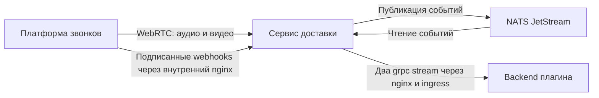

# Доставка медиа и событий звонков

## Назначение и границы

Сервис доставляет аудио, видео и события звонков на backend плагина с минимальной задержкой. Несколько плагинов могут независимо получать данные звонка или выбранного участника.

Декодирование, ML и бизнес-логика выполняются в плагине. Каталог плагинов, iframe, выдача прав и команды управления звонком находятся за границами сервиса. Авторизация получателей требует отдельной интеграции.

## Компоненты и размещение

- Платформа звонков предоставляет медиатреки и отправляет события. OpenVidu на базе LiveKit служит эмулятором VK Звонков.
- Сервис доставки работает в нашей инфраструктуре: управляет подписками, получает выбранные треки и обрабатывает события. При переносе на VK меняется адаптер платформы.
- NATS JetStream хранит события с ограничениями по объему и сроку. Медиа через него не проходит. Окружения используют отдельные потоки событий.
- Nginx открывает разработчикам grpc через TLS и распределяет подключения между экземплярами сервиса. Webhooks и служебные HTTP-ручки доступны только внутри инфраструктуры.
- Backend плагина работает у разработчика. Он открывает подписки, обрабатывает данные и восстанавливает соединение после обрыва.

## Взаимодействия и контракты



### Медиа

Плагин открывает `MediaService.Subscribe` с указанием звонка и фильтров по участнику, треку или типу медиа. Сервис проверяет соответствие комнаты запуску звонка и подключается как служебный получатель без права публикации.

Подключение к звонку и прием трека переиспользуются между подписчиками одного экземпляра. Прием включается по запросу и учитывает новые треки. После закрытия последней медиаподписки на звонок подключение освобождается.

Клиент получает описание трека и кодека, RTP-пакеты и сообщение о завершении трека. WebRTC-соединение заканчивается на сервисе, дальше данные идут через grpc без декодирования и транскодирования.

### События

Платформа отправляет `POST /webhooks/livekit` через внутренний nginx. Сервис проверяет подпись, преобразует событие в общий формат и публикует в JetStream. Для поддерживаемого события `204` означает подтверждение записи; при сбое или перегрузке возвращается `503` для повтора отправителем. Неподдерживаемые типы подтверждаются без публикации.

Плагин открывает `EventService.Subscribe` для звонка с необязательными фильтрами по участнику и типам событий. Каждый экземпляр читает JetStream независимо и обслуживает своих подписчиков. Клиент получает новые события без воспроизведения истории после переподключения. Подтверждение webhook не означает доставку плагину. Дедупликация webhook ограничена временным окном; ровно однократная доставка клиенту не гарантируется.

### Примеры подписок

Условная запись полей запросов:

```text
MediaService.Subscribe:
  call_id: RM_example
  room_name: team-call
  participant_id: user-42
  kinds: [MEDIA_KIND_AUDIO]

EventService.Subscribe:
  call_id: RM_example
  event_types: [participant.joined, track.published]
```

`call_id` обозначает конкретный запуск звонка, `room_name` - имя комнаты. В LiveKit это SID комнаты и ее имя; `participant_id` соответствует identity участника, `track_id` - SID трека. Пустые фильтры означают все доступные данные выбранного звонка. Состав и соответствие типов событий задаются конфигурацией.

Событие содержит идентификатор, тип, источник, звонок, время возникновения и, когда применимо, участника и трек. Порядок доставки может отличаться от времени возникновения. Точные форматы: [медиа](https://github.com/dwspurpleteam/streamapi/blob/main/api/proto/streamapi/v1/media.proto), [события](https://github.com/dwspurpleteam/streamapi/blob/main/api/proto/streamapi/v1/events.proto).

Для привязки подписок к экземпляру клиент передает metadata `x-call-id`, равную `call_id`. После обрыва stream подписывается заново. Идентификаторы и маршрутизация не заменяют авторизацию.

## Требования и критерии приемки

- **Изоляция звонка**: доставка работает вне критического пути звонка. Проверка: отключение сервиса, NATS или плагина не прерывает разговор между участниками.
- **Фильтрация**: подписки разных звонков и участников не смешивают данные. Проверка: параллельные клиенты получают только выбранные источники.
- **Backpressure**: очереди ограничены по объему и возрасту; бюджеты ограничивают подписки, память и исходящий медиатрафик. Проверка: медленный клиент отключается с `ResourceExhausted`, остальные продолжают получать данные.
- **Ограниченное хранение**: отсутствие читателей не вызывает бесконечный рост JetStream. Проверка: срок хранения освобождает место, заполнение возвращает `503` на новые события.
- **Восстановление**: сбой источника завершает затронутые подписки с ошибкой. Проверка: после восстановления повторная подписка работает; закрытие освобождает ресурсы.
- **Масштабирование**: экземпляры обслуживают клиентов через общий вход. Проверка: распределение звонков сохраняет фильтрацию и доставку событий всем подписчикам.
- **Наблюдаемость**: метрики отражают нагрузку, задержки доставки, отказы и медленных клиентов. Проверка: нагрузка и сбои меняют соответствующие показатели. Лимиты и таймауты задаются конфигурацией.

## Открытые вопросы

Как управляющий backend выдает, проверяет и отзывает разрешения плагина на конкретный звонок, участников и типы данных?
