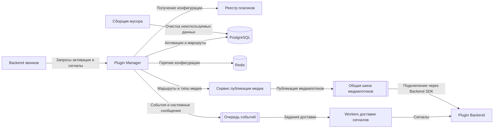

Plugin Manager управляет состоянием плагинов в звонке и предоставляет маршруты сервисам маршрутизации трафика.
## Ответственность сервиса
```text
Plugin Manager — control plane
├── жизненный цикл активаций
├── получение и фиксация манифеста
├── управление сигнальными подписками
└── управление медиамаршрутами
```
## Сценарии использования
### 1. Получение конфигурации плагина из реестра
1. Plugin Manager получает идентификатор плагина и метаинформацию по реестру.
2. Plugin Manager запрашивает конфигурацию плагина в реестре.
3. Plugin Manager возвращает полученную конфигурацию плагина.
### 2. Регистрация активации плагина
1. Plugin Manager получает запрос на регистрацию активации:
   ```json
   {
     "callId": "call-10",
     "pluginId": "example-plugin",
     "pluginRegistryId": "example-registry",
     "requestedBy": "user-12",
     "idempotencyKey": "activate-call-10-example-plugin"
   }
   ```
2. Plugin Manager создаёт активацию в состоянии `ACTIVATING`.
3. Plugin Manager проверяет состояние плагина.
4. Plugin Manager регистрирует маршруты в базе для переиспользования готовых маршрутов без повторного получения конфигурации плагина.
5. Plugin Manager возвращает `activationId`, с которым будет выполняться дальнейшая работа.
### 3. Перенаправление сигналов backend звонков
1. Plugin Manager получает `activationId` и сигнал.
2. Plugin Manager получает из реестра плагинов или кеша манифест плагина.
3. По манифесту Plugin Manager определяет адрес, на который необходимо перенаправить сигнал.
4. Plugin Manager записывает сигнал в очередь для последующей обработки workers.
5. В очередь записываются полезная нагрузка события и `dst`-адрес для отправки.
### 4. Приостановление работы плагина
1. Звонок не проявляет активности в течение заранее определённого времени.
2. Plugin Manager публикует в очередь системное сообщение для отключения плагина от общих ресурсов и освобождения соединений.
3. Активация плагина переводится в состояние `SUSPENDED`.
### 5. Восстановление работы плагина
1. Звонок возобновляет активность.
2. Plugin Manager отправляет системное сообщение о восстановлении доступа к ресурсам.
3. Plugin Manager ожидает ответ от плагина.
4. После получения ответа Plugin Manager может отправить накопленные сообщения в плагин.
## Статусная модель активации

Для статусов используется единый стиль: английские прилагательные или причастия в верхнем регистре.

| Статус | Описание |
|---|---|
| `ACTIVATING` | Получен запрос на регистрацию плагина, выполняется активация. |
| `ACTIVE` | Плагин получил необходимую информацию о звонке, и Plugin Manager подтвердил, что плагин работает. |
| `DEGRADED` | Плагин деградирует под нагрузкой. Запросы к нему приостанавливаются с целью восстановления работоспособности под более низкой нагрузкой. |
| `SUSPENDING` | Промежуточное состояние перед приостановлением плагина. |
| `SUSPENDED` | Данные в плагин не поступают, общие ресурсы и соединения могут быть освобождены. |
| `RESUMING` | Плагин возвращается из состояния `SUSPENDED`. |
| `STOPPING` | Плагин выводится из использования в звонке при наступлении stop policy или завершении звонка. Механизм stop policy планируется к реализации в следующих версиях. |
| `STOPPED` | Плагин выведен из использования в звонке. |
| `FAILED` | При работе с плагином возникла ошибка, не позволяющая продолжить работу. |

## Хранимые модели данных
Все примеры моделей представлены в JSON и используют `camelCase` для имён полей.
### Activation

```json
{
  "activationId": "act-42",
  "callId": "call-10",
  "pluginId": "example-plugin",
  "pluginVersion": "1.0.0",
  "registryId": "example-registry",
  "state": "ACTIVATING",
  "stateChangedAt": "2026-10-15T12:00:00Z",
  "idempotencyKey": "activate-call-10-example-plugin"
}
```
Назначение полей:
- `activationId` — первичный ключ активации;
- `callId` — идентификатор звонка; по этому полю можно выполнять партиционирование;
- `pluginId` — идентификатор плагина;
- `pluginVersion` — версия плагина;
- `registryId` — идентификатор реестра для более быстрого поиска конфигурации;
- `state` — состояние активации;
- `stateChangedAt` — дата установки состояния; по этому полю предполагается кластеризация;
- `idempotencyKey` — ключ идемпотентности.
### Route

```json
{
  "routeId": "route-101",
  "pluginId": "example-plugin",
  "version": "1.0.0",
  "pluginRegistry": "example-registry",
  "signalDst": "https://plugin.example.com/signals",
  "mediaDst": "wss://plugin.example.com/media",
  "mediaDstTypes": [
    "AUDIO",
    "VIDEO"
  ]
}
```

Назначение полей:
- `routeId` — идентификатор маршрута;
- `pluginId` — идентификатор плагина;
- `version` — версия плагина;
- `pluginRegistry` — реестр плагинов;
- `signalDst` — адрес перенаправления сигналов по push-модели;
- `mediaDst` — адрес перенаправления WebRTC-потоков;
- `mediaDstTypes` — типы медиапотоков для передачи.

Необходимость хранения маршрутов остаётся под вопросом. Планируется публикация медиапотоков в общую шину отдельным сервисом. На уровне Backend SDK предполагается предоставить возможность подключения к необходимым потокам в шине. В Plugin Manager можно хранить только необходимые типы медиапотоков, чтобы не передавать через шину лишние данные.
### Event

```json
{
  "eventId": "event-501",
  "eventType": "participant.joined",
  "schemaVersion": "1",
  "callId": "call-10",
  "sequence": 142,
  "participantId": "participant-7",
  "occurredAt": "2026-10-15T12:00:00Z",
  "correlationId": "correlation-25",
  "payload": {}
}
```

`sequence` — номер события в последовательности, используемый для сериализации событий.
### EventDelivery

```json
{
  "deliveryId": "delivery-801",
  "eventId": "event-501",
  "activationId": "act-42",
  "attempt": 1,
  "createdAt": "2026-10-15T12:00:01Z"
}
```
## Работа с конфигурацией плагина

Конфигурация плагина в Plugin Manager не хранится. При необходимости она получается из реестра или кеша.

Для реестра принимается предположение, что определённая загруженная версия плагина статична и не изменяется. Каждое изменение создаёт новую версию плагина.

## Высокоуровневая архитектура


## Требования к архитектуре сервиса

- хранилище с моделью активации;
- кеш для хранения горячих конфигураций плагинов;
- стенд, который получает конфигурации и управляет их состояниями;
- очередь событий из звонка, которые впоследствии отправляются workers в плагины;
- сборщик мусора — процесс, очищающий базу от неиспользуемых маршрутов, активаций и конфигураций плагинов.

## Требования безопасности

Вопросы безопасности будут рассмотрены в следующих итерациях проекта.

## Стек системы

### Язык и фреймворк
Kotlin + coroutines + Quarkus.

Обоснование: 
Kotlin позволяет эффективнее использовать ресурсы при I/O-нагрузке. Quarkus ориентирован на container-first подход, что позволяет получить минимальное startup time при масштабировании.
### Хранилища данных
PostgreSQL и Redis.

Обоснование:
- PostgreSQL позволяет использовать строгую схему и обеспечивает согласованность данных при параллельных запросах;
- Redis обеспечивает быстрый доступ к записям в кеше.
### Межсервисное взаимодействие
Для взаимодействия с другими сервисами используется REST/HTTP.
