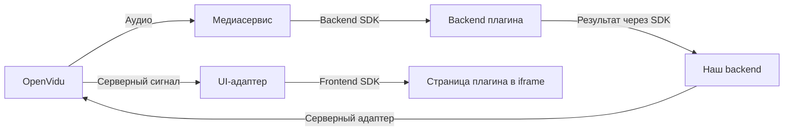

# Сервис плагинов для VK Звонков

## Назначение и границы

Платформа подключает к звонку внешние плагины: страницу разработчика в iframe и его backend. Через SDK плагин получает контекст пользователя, данные звонка и разрешенные возможности. По устройству это близко к [VK Mini Apps](https://github.com/VKCOM/vk-apps-launch-params/blob/master/README.md).

OpenVidu служит эмулятором недоступных нам VK Звонков. На стенде он и наши сервисы работают на одном сервере. Интеграцию с платформой выносим в адаптеры, чтобы при переносе сохранить каталог, управление плагинами, SDK и код разработчиков.

Прикладные плагины проекта: учет активности участников (сообщения, время с активным микрофоном и время в звонке) и викторины с агрегированными результатами. Субтитры на диаграмме ниже иллюстрируют путь обработки медиа.

## Компоненты и размещение


Исходник: [`diagrams/components.puml`](diagrams/components.puml)

На PNG-диаграммах сохранен ранний вариант передачи медиа через Plugin Manager. В текущем разделении Plugin Manager управляет подключением, а медиа и события доставляет отдельный streamapi. Это различие нужно учитывать при чтении стрелок `MediaControl` и `Media Input`.

### Plugin Registry

Наш отдельный сервис вне OpenVidu. Хранит описания плагинов: адреса UI и backend, версию контракта, входные данные и запрашиваемые возможности. Панель получает из него каталог, Plugin Manager - доверенное описание для запуска. Права конкретного подключения определяет Plugin Manager.

### Plugin Manager и Activation Store

Наш backend вне OpenVidu. Проверяет пользователя, права и квоты, создает и останавливает подключения, определяет доступные источники и адресатов. Activation Store хранит связь плагина со звонком, настройки и состояние подключения. Plugin Manager управляет жизненным циклом; передачей медиапакетов занимается сервис доставки.

### Доставка медиа и событий

Отдельный сервис в нашей инфраструктуре. Получает выбранные треки через адаптер платформы и передает backend плагина по grpc. Подписанные webhooks преобразует в общие события, записывает в NATS JetStream и доставляет отдельным grpc stream. Отвечает за подписки, ограниченные очереди и изоляцию получателей. Декодирование и бизнес-логика принадлежат плагину.

### Result Gateway

Вход для результатов и команд Plugin Backend. Проверяет подпись, формат и размер сообщения; передает его Plugin Manager для проверки прав, адресатов и лимитов. Это логический компонент нашего backend, отдельный микросервис для него не обязателен.

### Адаптеры OpenVidu

UI Adapter добавляем в `meet-ce/frontend`: панель управления, контейнер плагина и bridge для iframe. На плагин создается один UI-контейнер виртуального участника без публикации RTC-потока. Интерфейс учитывает роль пользователя; Network Monitor передает сигналы для приостановки и возобновления обработки отдельного участника.

Call Adapter реализуем в нашем проекте. Он подтверждает контекст пользователя и доставляет проверенные действия через Meet API. В `meet-ce/backend` добавляем недостающие точки контекста и серверных сигналов. Медиа- и событийный адаптеры работают в сервисе доставки. SFU не дорабатываем.

### SDK и код разработчика

Frontend SDK работает в странице плагина: принимает контекст и запрашивает возможности звонка. Backend SDK принимает данные, публикует результаты и команды. Разработчик размещает страницу и backend на своей стороне, отвечает за обработку, сессии и изоляцию звонков. Серверные проверки платформы обязательны при любом SDK.

## Взаимодействия и контракты

Примеры поясняют границы обмена; окончательные схемы API согласует команда. `callId` обозначает конкретный запуск звонка, `activationId` - подключение плагина. В адаптере OpenVidu используются `Room.sid`, `Participant.identity` и `TrackInfo.sid`; для вызовов API также нужно имя комнаты.

### Подключение и остановка


Исходник: [`diagrams/sequence-activation.puml`](diagrams/sequence-activation.puml)

1. Разработчик регистрирует плагин. Новые записи доступны без пересборки клиента, перезапуска сервисов и изменения nginx.
2. Пользователь запрашивает подключение per-call или per-user. Plugin Manager подтверждает его полномочия через адаптер, берет описание из каталога и проверяет лимиты. Повторный запрос с тем же ключом возвращает существующее подключение.
3. Plugin Manager создает `activationId` и асинхронно запускает Plugin Backend. После готовности разрешает получение данных и сообщает участникам об интерфейсе плагина. Звонок не ожидает завершения запуска.
4. Отключение, завершение звонка или истечение разрешения прекращает передачу данных и прием команд, закрывает интерфейс и освобождает ресурсы. Ответ плагина для остановки не требуется.

На диаграмме показано подключение на звонок. Область обработки данных и адресаты результатов задаются отдельно; в одном звонке могут работать несколько плагинов. Ошибка запуска затрагивает только соответствующее подключение. Вошедший позже участник получает актуальное состояние.

### Пользователь и iframe

UI Adapter открывает `uiUrl` из каталога и после готовности Frontend SDK передает подписанный контекст запуска: плагин, подключение, звонок, пользователя, участника и разрешения. Контекст возвращается вместе с ответом на открытие плагина; отдельный запрос за токеном не нужен.

Plugin Backend проверяет подпись локально по публичному ключу платформы и создает свою сессию. Токены и секреты OpenVidu ему не передаются. `userId` позволяет узнавать пользователя в пределах плагина; для гостя действует в пределах звонка. Контекст ограничен получателем, сроком и одноразовым идентификатором.

Действия внутри плагина, например выбор языка, идут из iframe прямо к его backend с собственной сессией. Запрос возможностей звонка идет через Frontend SDK и UI Adapter в наш backend. Bridge использует `postMessage`; проверяются точный origin, окно iframe и подключение. Подпись на каждое сообщение bridge не запрашивается.

Для встраивания соблюдаем общие правила:

- Клиент один раз разрешает `frame-src https:`; адреса берутся из каталога. Разработчик разрешает встраивание через `frame-ancestors` и исключает конфликтующий `X-Frame-Options`.
- Страница размещается на отдельном origin и запускается в sandbox с `allow-scripts allow-same-origin`. Камера, микрофон и прочие дополнительные возможности по умолчанию закрыты.
- Токен передается только точному origin после готовности SDK, без wildcard и помещения в URL. Сессию храним в памяти страницы и передаем через `Authorization`; сторонние cookies не нужны.
- На одном origin UI и API CORS не требуется. При разных origin разработчик настраивает `connect-src` страницы, CORS и preflight на своем API. Ошибка встраивания затрагивает только UI плагина; общего прокси его бизнес-запросов не добавляем.

### Данные, результаты и команды



Backend плагина подписывается на разрешенные источники независимо от iframe. Подключение к звонку и прием трека переиспользуются между подписчиками одного экземпляра сервиса доставки. В интеграции streamapi передаются RTP-пакеты с описанием трека; декодирование выполняет плагин. События идут через JetStream с ограниченным хранением, без воспроизведения истории клиенту после переподключения.


Исходник: [`diagrams/sequence-subtitles.puml`](diagrams/sequence-subtitles.puml)

Обычный звук идет от SFU участникам напрямую. Плагин получает параллельную копию, выполняет обработку и отправляет результат через Backend SDK в Result Gateway. Plugin Manager проверяет активность подключения, возможности, адресатов и частоту. Повторы отсеиваются по `messageId`, обновления сводятся по ключу и ревизии; поздние результаты остановленного подключения отбрасываются.

Например, плагин запрашивает уведомление:

```json
{
  "type": "call.notify",
  "messageId": "command-a",
  "activationId": "activation-a",
  "callId": "call-a",
  "recipients": ["participant-a"],
  "payload": { "text": "Перевод включен" }
}
```

`recipients` содержит участников этого звонка. Пустой список отклоняется, чтобы случайно не разослать данные всем. Для субтитров результат дополнительно содержит говорящего, текст, идентификатор фразы, ревизию и признак завершения.

Управляющие запросы между backend платформы и плагина подписываются отправителем и проверяются получателем локально. Подпись связывает метод, адрес, тело, время и nonce; просроченные подписи и повтор nonce отклоняются. При повторе операции сохраняется `messageId` и меняется nonce. Ключи разделены по плагинам и допускают ротацию. Подпись не заменяет проверку прав.

Проверенный результат или команду Call Adapter передает Meet Backend, который отправляет адресный серверный сигнал через `sendData`. UI Adapter проверяет серверного отправителя, показывает результат или передает его в iframe. Серверные действия выполняет адаптер платформы; воспроизведение звука учитывает ограничения браузера.

Команды асинхронны, время ожидания и повторы ограничены. `command.applied` подтверждает исполнитель. После переподключения восстанавливаются актуальные результаты, старые команды и медиа не воспроизводятся. Большие результаты передаются отдельно от серверных сигналов. При отсутствии команд и результатов звонок ничего не выполняет; доступность плагина проверяется отдельно.

## Требования и критерии приемки

- Звонок работает при падении или зависании любого компонента плагинов. Проверка: отказ backend плагина, сервиса доставки или iframe не мешает разговору, входу и переподключению участников.
- Очереди и буферы ограничены по размеру и возрасту отдельно для получателей и источников. При перегрузке снижаем качество, пропускаем устаревшее видео, отмечаем разрывы аудио или приостанавливаем обработку. Проверка: медленный плагин или участник не задерживает остальных, память не растет неограниченно.
- Компоненты плагинов имеют бюджеты CPU, памяти и сети с резервом для звонка; ограничены подписки, iframe и частота команд. Проверка: при исчерпании бюджета новые подключения отклоняются, существующий звонок продолжается.
- Истечение разрешения останавливает доступ даже при недоступном Plugin Manager. Проверка: остановленное подключение не получает данные и не может публиковать поздние результаты; данные разных звонков и закрытые результаты не смешиваются.
- Нагрузка распределяется между экземплярами с привязкой медиасессий. Проверка: замена экземпляра допускает переподключение клиента, а старый владелец обработки теряет право публиковать результаты.
- SLA плагина задает бюджет near real-time задержки, доступность и допустимую нагрузку; численные цели согласует команда. Проверка: на открытых или синтетических данных измеряются end-to-end latency, jitter, очереди, ошибки и влияние на звонок. Для выбранного ML-плагина также измеряется качество.
- MVP включает хотя бы один сквозной плагин. Проверка: регистрация, подключение на лету, обработка, агрегация результата, отображение и остановка проходят без переподключения участников.

## Открытые вопросы

- Какие методы контекста, ролей и серверных сигналов добавляем в Meet API? Смену роли нужно получать от Meet: webhooks LiveKit ее не описывают.
- Как Plugin Manager передает и отзывает разрешения в сервисе доставки? Дополнительные автоматические политики остановки требуют отдельного согласования.
- Как согласовать направление `CallPort` на диаграмме компонентов со сценариями, где Plugin Manager вызывает Call Adapter?
- Какие возможности получения медиа, подтверждения пользователя, доставки действий и встраивания доступны в VK Звонках?
