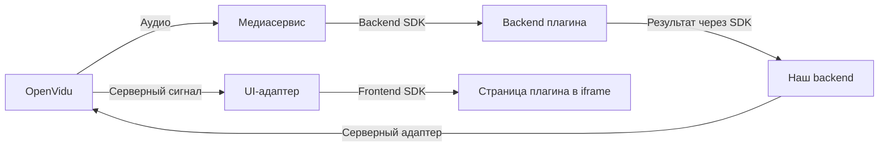

# Сервис плагинов для VK Звонков

Видение для обсуждения с командой. Плагин - страница и backend разработчика; наша платформа дает им контекст пользователя, данные звонка и возможности через SDK. Ориентир - [VK Mini Apps и подписанный контекст запуска](https://github.com/VKCOM/vk-apps-launch-params/blob/master/README.md).

OpenVidu заменяет недоступные нам VK Звонки и служит эмулятором. OpenVidu и наши серверные компоненты разворачиваем на одном сервере. Общий backend и SDK работают через платформенные адаптеры; внутреннюю структуру кода и окончательные контракты согласует команда.

## Компоненты и границы

Наша серверная часть состоит из backend управления плагинами и медиасервиса. Адаптеры - код интеграции с платформой звонков, SDK - библиотеки для разработчика плагина. Разделение на компоненты задает границы ответственности. Пути ниже указаны относительно репозитория `openvidu-meet`.

### Наш backend

Реализуем в нашем проекте, вне OpenVidu. Он хранит каталог и подключения, выдает токены, сводит результаты и определяет адресатов. Решает, кому можно подключить плагин, какие данные ему дать и какие команды принять; владеет правами и квотами. Медиа и интерфейс обслуживают другие компоненты.

Backend включает в себя:
- Plugin manage сервис. Сервис подключается к хранилищу информации о подключенных в звонках плагинах и к конфигурации плагинов. Его задача направлять сигналы платформы звонков по нужным плагинам и отдавать конфигурацию для перенаправления медиа потков.
- Media router сервис

### Media router сервис с адаптером источников

Реализуем в нашем проекте, вне OpenVidu. Он получает разрешенные аудио и видео из звонка и доставляет их плагинам. Изолирует очереди, чтобы медленный обработчик не задерживал звонок и другие плагины. Использует права, выданные нашим backend; распознавание речи и любая другая бизнес-логика принадлежат плагину.

Пример конфигурации маршрута
```json
{
  "routeId": "route-101",
  "activationId": "act-42",
  "pluginId": "example-plugin",
  "callId": "call-10",
  "state": "ACTIVE",
  "destination": {
    "transport": "WEBRTC",
    "endpoint": "wss://plugin.example/media",
    "sessionId": "plugin-session-501",
    "credentialRef": "media-token-789"
  },
  "trackSelectors": [
    {
      "mediaType": "VIDEO",
      "participants": "ALL",
      "sources": ["CAMERA"]
    }
  ]
}
```
routeId - id маршрута

activationId - id активации (активация связывает плагин и звонок)

callId - id звонка

pluginId - id плагина

state - состояние маршрута

destination - информация о конечной точке маршрутизации потока

trackSelectors - получаемые медиа данные для перенаправления в бекенд плагина

### UI-адаптер

Добавляем во frontend OpenVidu Meet, `meet-ce/frontend`. Он встраивает страницу разработчика в звонок, передает ей контекст, показывает результаты и выполняет проверенные команды, например выводит уведомление. Управляет iframe и интерфейсом звонка; разрешения на действия проверяет наш backend.

Для активного плагина OpenVidu Meet создаёт специальное UI-представление виртуального участника. Оно использует контейнер, аналогичный контейнеру демонстрации экрана, но вместо видеотрека отображает iframe Plugin UI. Виртуальный участник не публикует пользовательский RTC-поток. Содержимое и доступность контейнера могут зависеть от роли текущего пользователя.

Для каждого плагина создается максимум один виртуальный участник

### Plugin manage сервис с серверным адаптером

Связывает общий backend с OpenVidu: подтверждает участие пользователя, получает события и доставляет проверенные действия через API платформы. Код адаптера пишем в нашем проекте; в `meet-ce/backend` добавляем точку контекста со штатной авторизацией Meet. Здесь сосредоточены API и идентификаторы платформы; правила доступа к плагинам остаются в нашем backend. При переносе в VK меняем эту интеграцию.

Plugin Manager владеет желаемым состоянием медиамаршрутов. При активации, изменении конфигурации или отключении плагина он отправляет Media Routing Controller команды создания, обновления или удаления маршрута. Media Router не читает хранилище активаций напрямую.

### Хранилище подключений
Хранилище подключений содержит информацию о том к каким звонкам какие плагины подключены и какие на текущий момент времени у них состояния. Хранилище обслуживает несколько звонков одновременно

Возможные значения состояния активации плагина:
```
ACTIVATING
RUNNING
DEGRADED
PAUSED
STOPPING
STOPPED
FAILED
```

Модель активации плагина в звонке
```json
{
  "activationId": "act-42",
  "pluginId": "example-plugin",
  "pluginVersion": "1.0.0",
  "callId": "call-10",
  "state": "ACTIVATING",
  "configuration": {},
  "stopPolicy": {},
  "createdAt": "2026-10-10T10:00:00Z"
}
```
stopPolicy - политика остановки плагина на данный момент не рассматривается в реализации. Будет сделано в следующих релизах


### Контракт и SDK

Разрабатываем как общие пакеты нашей платформы вне OpenVidu. Frontend SDK работает в странице плагина: получает контекст и запрашивает возможности звонка. Backend SDK работает в backend плагина: принимает данные, отправляет результаты и команды. Оба используют общий контракт; серверные проверки прав остаются обязательными.

### Страница и Plugin Backend

Разработчик реализует их в своем проекте. Например, страница дает выбрать язык субтитров, а backend распознает речь и возвращает текст. Разработчик отвечает за свой UI, обработку, сессию пользователя и SLA; с нашей платформой работает через SDK.

### Стенд и наблюдаемость

Готовим настройки запуска OpenVidu, нагрузочные сценарии и сбор метрик компонентов. Каждый владелец отвечает за метрики своей части.

Пример пути субтитров: плагин распознает речь, наш backend проверяет адресатов, UI показывает разрешенный результат.



## Подключение плагина

1. Разработчик регистрирует плагин через API каталога. Новые записи доступны в текущем звонке без перезапуска сервисов, изменения nginx и пересборки клиента. Пример описания:

   ```json
   {
     "pluginId": "caption-helper",
     "contractVersion": "1",
     "uiUrl": "https://plugin.example.com/app",
     "backendUrl": "https://plugin.example.com/api",
     "inputs": ["audio", "call.events"],
     "capabilities": ["result.subtitles", "call.notify"]
   }
   ```

2. Область активации плагина весь звонок per-call. Область обработки данных плагином per-user. Backend проверяет права и лимиты, создает `activationId` и разрешает нужные входы и действия.
3. Plugin Backend подтверждает готовность к обработке; затем медиасервис подает разрешенные данные. Основной звонок этого не ждет.
4. UI открывает iframe для разрешенных пользователей и передает каждому его подписанный контекст запуска.
5. Отключение плагина или завершение звонка прекращает передачу данных и прием команд, закрывает iframe и освобождает ресурсы. Ответ Plugin Backend для остановки не нужен.

В звонке может работать несколько плагинов. `callId` обозначает запуск звонка, `activationId` - подключение одного плагина. Область обработки и адресаты результатов задаются отдельно.

## Пользователь и iframe

`Пользователь → страница в iframe ↔ backend разработчика`

UI открывает `uiUrl` из разрешенной записи каталога. Наш backend возвращает подписанный токен запуска вместе с ответом на подключение или открытие плагина; отдельный запрос за токеном не нужен. Через bridge передаем его в iframe. Пример подтвержденного контекста:

```json
{
  "pluginId": "caption-helper",
  "activationId": "activation-a",
  "callId": "call-a",
  "userId": "user-a",
  "participantId": "participant-a",
  "permissions": ["call.notify"]
}
```

Наш backend подписывает контекст с получателем, сроком действия и одноразовым идентификатором. В первом API-запросе страницы Plugin Backend проверяет подпись локально, по заранее полученному публичному ключу платформы, и возвращает свою сессию. Отдельный вызов нашего backend для проверки подписи не требуется. `userId` позволяет узнавать авторизованного пользователя в пределах плагина; для гостя действует только в пределах звонка. `participantId` обозначает участие в звонке. Токены OpenVidu разработчику не передаем.

Пользовательские действия внутри плагина, например выбор языка, идут из страницы к Plugin Backend с его сессией. Сообщения bridge передаем через [postMessage](https://developer.mozilla.org/en-US/docs/Web/API/Window/postMessage) внутри браузера, без HTTP-запроса за подписью каждого сообщения. Новый контекст нужен при повторном запуске интерфейса, а не перед каждым действием. Запросы возможностей звонка через Frontend SDK проходят проверку нашего backend. Долгоживущие ключи подписи в браузер не передаем.

Управляющие запросы между нашим backend и Plugin Backend подписывает сервер отправителя локально, проверяет получатель; обращение к отдельному сервису подписи не требуется. Отдельный ключ на плагин; например, HMAC-SHA-256 связывает метод, адрес с query, хеш тела, время и nonce. Ключи допускают ротацию; просроченные подписи и повтор nonce отклоняем. Подпись не заменяет проверку прав. Формат ориентируем на [HTTP Message Signatures](https://www.rfc-editor.org/rfc/rfc9421.html).

### Встраивание и запросы

- В CSP клиента один раз разрешаем [`frame-src https:`](https://developer.mozilla.org/en-US/docs/Web/HTTP/Reference/Headers/Content-Security-Policy/frame-src); остальные директивы сохраняют ограничения. Домены берутся из каталога. Более строгие CSP согласуем при первоначальной интеграции: дополнительная политика не отменяет запрет.
- Bridge проверяет точный origin из `uiUrl`, окно iframe и подключение. Токен передаем после готовности SDK только этому origin, без wildcard и помещения в URL. Редирект на другой origin доступа не дает; ожидание готовности ограничено.
- Используем [sandbox](https://developer.mozilla.org/en-US/docs/Web/HTML/Reference/Elements/iframe) с `allow-scripts allow-same-origin` только для страницы на другом origin относительно звонка. Камеру, микрофон, верхнюю навигацию и всплывающие окна по умолчанию не разрешаем.
- Разработчик разрешает домены платформы в [frame-ancestors](https://developer.mozilla.org/en-US/docs/Web/HTTP/Reference/Headers/Content-Security-Policy/frame-ancestors), включая всех родителей при вложенных iframe, и исключает конфликтующий `X-Frame-Options: DENY/SAMEORIGIN`.

Пример заголовка страницы плагина:

```http
Content-Security-Policy: frame-ancestors https://calls.example.org; connect-src 'self'
```

Запрос страницы к своему API на том же origin не требует CORS. Для API на другом origin разработчик разрешает его в `connect-src` и на ответах API и preflight задает, например:

```http
Access-Control-Allow-Origin: https://plugin.example.com
Access-Control-Allow-Methods: GET, POST
Access-Control-Allow-Headers: Authorization, Content-Type
```

Сессию передаем через `Authorization`, токен храним в памяти страницы; сторонние cookies не требуются. После перезагрузки повторяем запуск. Запрет встраивания или CORS нельзя обойти на клиенте; общий прокси бизнес-запросов плагина не добавляем. Ошибка iframe затрагивает только интерфейс плагина.

## Данные для обработки

`Медиасервер → наш медиаадаптер → Backend SDK → Plugin Backend`

В OpenVidu разрешенные треки получает служебный RTC-получатель через [штатные подписки SFU](https://github.com/OpenVidu/openvidu-livekit/blob/2f779fc1fd142add2d97d22c85fa97920dfa3e09/pkg/rtc/subscriptionmanager.go). Он может только принимать, не отображается как участник и не удерживает звонок после ухода людей. SFU не дорабатываем. Медиасервис передает плагину аудио, видео и доступные события или метаданные в общем формате, независимо от iframe.

Пример описания аудиофрагмента; само медиа идет отдельным потоком или бинарными данными:

```json
{
  "type": "input.audio",
  "activationId": "activation-a",
  "callId": "call-a",
  "participantId": "participant-a",
  "trackId": "audio-a",
  "sequence": 42,
  "receivedAtMs": 1791705600000,
  "discontinuity": false
}
```

`sequence`, `receivedAtMs` и `discontinuity` добавляет наш медиасервис: номер фрагмента, время его приема и обнаруженный разрыв доставки. При per-call разрешенный состав меняется вместе с участниками. Подписку на трек переиспользуем между плагинами, доставку каждому изолируем.

## Результаты и команды

Плагин может обратиться к нашей платформе двумя путями:

- Страница: `iframe → Frontend SDK → UI-адаптер → наш backend`.
- Обработка: `Plugin Backend → Backend SDK → наш backend`.

Backend проверяет отправителя, активное подключение, права, адресатов и лимиты. Страница действует от пользователя, Plugin Backend - от плагина. Пример команды:

```json
{
  "type": "call.notify",
  "messageId": "command-a",
  "activationId": "activation-a",
  "callId": "call-a",
  "recipients": ["participant-a"],
  "payload": { "text": "Перевод включен" }
}
```

`recipients` содержит `participantId`. Уведомление или звук выполняет UI-адаптер после проверенного серверного сигнала; серверное действие - адаптер платформы. Команды асинхронны, ожидание и повторы ограничены. `messageId` связывает запрос с подтверждением и защищает от повторного действия; при повторе подписи nonce меняется. Событие `command.applied` подтверждает исполнитель, а не успешная отправка сигнала. Для звука действуют ограничения браузера.

Пример результата обработки:

```json
{
  "type": "result.subtitles",
  "messageId": "result-a",
  "activationId": "activation-a",
  "callId": "call-a",
  "recipients": ["participant-a"],
  "payload": {
    "participantId": "participant-a",
    "utteranceId": "phrase-a",
    "revision": 2,
    "text": "Привет",
    "final": true
  }
}
```

Backend сводит обновления по ключу и ревизии и доставляет актуальный результат разрешенным клиентам, при необходимости в iframe. Собственные данные UI плагин может передавать напрямую. После переподключения восстанавливаем актуальные результаты; старые команды и накопленное медиа не воспроизводим. Если результатов и команд нет, звонок ничего не выполняет; доступность плагина проверяем отдельно.

## Нагрузка и отказы

Вход, выход, переподключение и медиапуть звонка работают без сервиса плагинов. Отказ Plugin Backend, нашего backend, медиасервиса или iframe отключает соответствующие возможности плагинов и не блокирует звонок.

- Для плагина согласуем SLA: бюджет near real-time задержки, доступность и нагрузку. Численные цели команда определяет до реализации.
- Очереди и транспортные буферы ограничены по размеру и возрасту, отдельно для подключений и источников. Медленный плагин не задерживает остальных. При перегрузке пропускаем устаревшее видео, отмечаем разрывы аудио, снижаем качество или приостанавливаем обработку.
- На общем сервере задаем лимиты CPU, памяти и сети компонентов плагинов с резервом для звонка. Ограничиваем число плагинов, iframe, подписок и частоту команд; при нехватке ресурсов отклоняем новое подключение.
- Доступ к медиа имеет ограниченный срок. При отключении или истечении разрешения останавливаем передачу, даже если управляющий backend недоступен. Поздние команды и результаты отключенных подключений отбрасываем.
- Для роста нагрузки допускаем горизонтальное масштабирование. Медиасессии закрепляем за рабочими экземплярами (session affinity); состояние переживает их замену, старый владелец обработки теряет право публиковать результаты.
- Измеряем задержку и jitter по стадиям, очереди, ошибки и влияние на звонок. На OpenVidu с открытыми или синтетическими данными проверяем нагрузку, отказы и изоляцию; для ML-плагина также качество результата.

## OpenVidu и перенос в VK Звонки

Описанные доработки Meet опираются на существующие [расширения панелей](https://github.com/OpenVidu/openvidu-meet/blob/a7f49bee8b133b367ad9c53a2a12716d4fec76a5/meet-ce/frontend/projects/shared-meet-components/src/lib/domains/meeting/openvidu-components/directives/template/openvidu-components-angular.directive.ts), [авторизацию](https://github.com/OpenVidu/openvidu-meet/blob/a7f49bee8b133b367ad9c53a2a12716d4fec76a5/meet-ce/backend/src/middlewares/auth.middleware.ts) и [серверные сигналы](https://github.com/OpenVidu/openvidu-meet/blob/a7f49bee8b133b367ad9c53a2a12716d4fec76a5/meet-ce/backend/src/services/frontend-event.service.ts). Добавляем bridge для вложенного плагина и обработчик его сигналов с проверкой серверного отправителя. Существующий iframe bridge предназначен для встраивания самого Meet в чужой сайт.

Сопоставление примеров с OpenVidu выполняет адаптер:

| Наше поле | Источник OpenVidu |
| --- | --- |
| `callId` | `Room.sid` конкретного запуска; для API также храним `Room.name` / `roomId` |
| `participantId`, `trackId` | `Participant.identity` внутри звонка и `TrackInfo.sid` |
| `userId` | Подтвержденный сервером контекст Meet; имя и произвольная metadata не удостоверяют пользователя |
| `recipients` | `destinationIdentities`; пустой список отклоняем, чтобы не получить рассылку всем |
| Остальные поля примеров | Наш протокол; OpenVidu не обязан иметь такие поля или действия |

Для жизненного цикла берем исходные webhooks LiveKit с `room.sid`, поскольку публичные webhooks Meet передают только `roomId`. URL адаптера задается в [конфигурации стенда](https://github.com/OpenVidu/openvidu/blob/14fedb3962c13b0f44758129b1c0d0a0cb3c9cad/openvidu-deployment/community/local-meet/docker-compose.base.yaml). После пропусков событий сверяем актуальное состояние.

Команды и небольшие результаты передаем через адресный серверный data packet с новым типом сигнала, который понимает наш UI-адаптер. У Meet нет готовых методов `call.notify` и `result.subtitles`. Для reliable packet учитываем [лимит 15 KiB и отсутствие доставки отключенным клиентам](https://docs.livekit.io/transport/data/packets/); медиа и большие результаты идут отдельным каналом.

Для VK Звонков заменяем UI-, серверный и медиаадаптеры; каталог, права, SDK и код плагина сохраняются. Возможности получения медиа, подтверждения контекста, доставки действий и CSP в VK еще нужно подтвердить.

Команда согласует первый плагин, форматы и транспорт, набор действий SDK, права пользователей, SLA и ресурсные лимиты.
